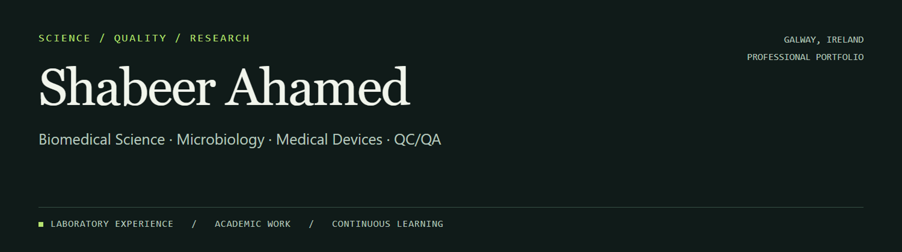

<a href="#experience">Experience</a> &nbsp; · &nbsp; <a href="#education-and-practical-training">Education</a> &nbsp; · &nbsp; <a href="#academic-work">Academic work</a> &nbsp; · &nbsp; <a href="#skills-and-areas-of-development">Skills</a> &nbsp; · &nbsp; <a href="#connect">Connect</a>

---

Galway, Ireland · [LinkedIn](https://www.linkedin.com/in/shabeer-ahamed-4582a41bb/)

I'm an MSc Biomedical Science graduate from the University of Galway, with a BSc in Microbiology from Madras Christian College. My experience spans microbiology laboratory training, a quality-control internship and orthopaedic implant manufacturing.

My interests connect laboratory science with product development, quality and patient safety. I'm looking to build on this background through biomedical R&D, microbiology, QC/QA, clinical research support or entry-level regulatory affairs.

## Experience

| Organisation | Role | Dates |
| --- | --- | --- |
| Zimmer Biomet, Galway | Product Builder, 3D Manufacturing Unit | Apr–Oct 2026 |
| Avigen Biotech, Chennai | Microbiology Trainee & Research Assistant | Feb–Mar 2024 |
| Alpha LifeCare, Cuddalore | Quality Control Internship | May 2023–Jan 2024 |

<b>Explore my laboratory and manufacturing experience</b>

**Medical-device manufacturing:** manufactured and inspected orthopaedic implant components, followed production procedures and maintained production records at Zimmer Biomet.

**Microbiology:** trainee experience in microbial culturing, antibiotic susceptibility testing, environmental monitoring, microscopy, sample preparation and laboratory record-keeping at Avigen Biotech.

**Quality control:** internship experience in microbiological testing, PCR-based analyses, laboratory documentation and data-analysis support at Alpha LifeCare. This was an internship, not a senior quality or regulatory position.

---

## Education and practical training

**MSc Biomedical Science · University of Galway · 2024–2025**  
Academic work in biomedical research, tissue engineering, medical devices and healthcare regulatory affairs. Practical training includes supervised HeLa cell culture and university HPLC practicals.

**BSc Microbiology · Madras Christian College · 2020–2023**  
Studies in medical microbiology, molecular biology, immunology, virology and research methodology, supported by laboratory practicals.

**Molecular diagnostics internship · Veridian Micro Lab Pvt. Ltd. · Sep–Oct 2022**  
Training in molecular diagnostic workflows, including PCR, RT-PCR, Western blotting and colorimetry.

---

## Academic work

- **Tissue engineering and biomaterials:** taught-module group coursework on 3D-printed PLA scaffolds for tissue-engineering applications. This was collaborative coursework, rather than an individual dissertation.
- **Biomedical literature review:** academic review work on artificial intelligence in cardiac diagnostics and drug discovery.
- **Healthcare regulatory affairs:** academic projects and learning covering medical devices, EU MDR 2017/745 and US FDA requirements.

Project reports are not yet published here. Any future uploads will identify the original assignment, group context, my contribution and limitations.

---

## Skills and areas of development

<kbd>Microbiology</kbd> <kbd>PCR / RT-PCR training</kbd> <kbd>Medical devices</kbd> <kbd>Quality documentation</kbd>

| Area | Background |
| --- | --- |
| Microbiology | Culturing, aseptic practices, microscopy, environmental monitoring and microbiological QC exposure through trainee/intern roles |
| Molecular techniques | PCR and RT-PCR training; sequencing and primer-design exposure |
| Scientific tools | BioEdit, MEGA and NCBI for academic/training sequence-analysis work |
| Quality | Procedure-following, laboratory and production records, and experience in regulated medical-device manufacturing |
| Regulatory affairs | Academic exposure to EU MDR and FDA requirements; interest in technical documentation, clinical evidence and post-market activities |
| Clinical research | Career interest in study support, research ethics, documentation and data quality |

Clinical research and regulatory affairs are development areas, not claims of clinical-trial management or regulatory-submission experience. Academic and internship techniques are distinguished from professional manufacturing experience.

<b>How I label portfolio work and protect confidential information</b>

## Portfolio approach

This portfolio will bring together selected academic work and independent learning projects. Educational examples and synthetic datasets will be labelled clearly. No confidential employer records, identifiable patient data or private reference documents will be published.

---

## Connect

I'm interested in laboratory, research-support and quality opportunities, alongside entry-level pathways into clinical research and regulatory affairs.

[Connect with me on LinkedIn](https://www.linkedin.com/in/shabeer-ahamed-4582a41bb/)
